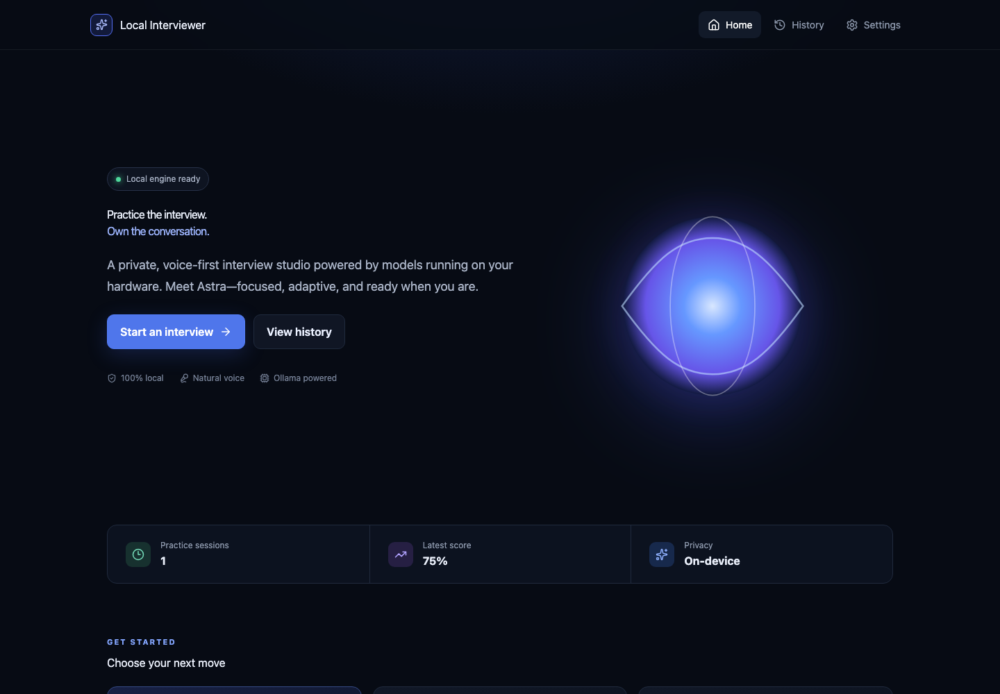

# Local Interviewer

Local Interviewer is a private, voice-capable AI interview simulator. **Astra** runs structured, adaptive practice interviews using a local or explicitly configured remote Ollama server. Sessions, transcripts, settings, and reports stay in local SQLite storage.



## Highlights

- Adaptive interview engine with explicit state transitions and curated offline question banks
- 15 interview categories, four difficulty levels, custom roles and durations
- Local Ollama profiles, model discovery, connection latency, Qwen thinking separation, structured decisions
- Browser microphone capture, real amplitude meter, push-to-talk, local Whisper adapters, transcript correction
- Local voice synthesis, playback cancellation, replay, mute, speed and volume preferences
- PDF/DOCX/TXT resume and job-description extraction on the local backend
- Evidence-bound evaluation, transparent weighted rubric, confidence, and practice disclaimer
- Persistent history, recovery after refresh, deletion, Markdown/JSON/PDF exports
- Dark responsive interface, accessible controls, reduced-motion support, no telemetry

## Architecture

React/TypeScript and Vite provide the browser application. FastAPI owns orchestration, security policy, speech adapters, exports, and all Ollama traffic. SQLAlchemy stores data in SQLite WAL mode. See [Architecture](docs/ARCHITECTURE.md).

```text
Browser (React + Web Audio) ──HTTP/WebSocket──> FastAPI
                                              ├── SQLite
                                              ├── Ollama (approved profile)
                                              ├── mlx-whisper / faster-whisper
                                              └── Kokoro adapter / local OS TTS
```

## Prerequisites

- macOS or Windows; Apple Silicon is the primary tested platform
- `uv`, Node.js 22+, npm, Git, and FFmpeg
- Ollama for model-backed interviews (offline question-bank mode works without it)
- Python 3.12 is downloaded and managed by `uv`

## Install and launch

```bash
git clone https://github.com/SparshSunilNaik/Local-Interviewer.git
cd Local-Interviewer
./setup.sh
./start.sh
```

Open **http://127.0.0.1:5173**. Stop only project-owned processes with `./stop.sh`. Run `./scripts/doctor.sh` for readiness diagnostics.

### Install local models explicitly

No large model is downloaded by setup.

```bash
ollama pull qwen3:8b
cd backend
uv sync --group stt-apple       # mlx-whisper package on Apple Silicon
# Whisper medium.en downloads on first explicit transcription (about 1.5 GB).
```

Kokoro MLX package compatibility varies by release. The currently resolved package is detected but not enabled until its runtime API is verified; macOS `say` is the explicit local basic fallback. This limitation is shown in diagnostics rather than silently using a cloud service.

## Configure Ollama

In **Settings → Ollama profiles**, save `http://127.0.0.1:11434`, select `qwen3:8b`, and test the connection. For a university server, use its exact approved URL (for example `http://host-or-private-ip:11434`), then test model availability. See [Remote Ollama](docs/REMOTE_OLLAMA.md).

## Audio

Select voice or text mode when creating an interview. In the room, recording stops before transcription; the candidate reviews and edits the result before submission. Recording and Astra playback are half-duplex. Raw audio persistence is off by default. See [Audio Pipeline](docs/AUDIO_PIPELINE.md).

## Development and tests

```bash
cd backend && uv run ruff check . && uv run pytest
cd ../frontend && npm run lint && npm test && npm run build
npm run test:e2e
```

The E2E suite uses deterministic offline interview behavior and does not prove physical microphone or speaker hardware. See [Testing](docs/TESTING.md).

## Documentation

- [macOS setup](docs/SETUP_MACOS.md) · [Windows setup](docs/SETUP_WINDOWS.md)
- [Interview engine](docs/INTERVIEW_ENGINE.md) · [Evaluation](docs/EVALUATION.md)
- [Security](docs/SECURITY.md) · [Troubleshooting](docs/TROUBLESHOOTING.md)

## Known limitations

- English speech recognition only.
- Automatic mode currently uses reliable utterance recording/confirmation, not word-by-word streaming or barge-in.
- Kokoro MLX is detected but disabled for the resolved version; local OS TTS is operational on macOS.
- Optional authenticated remote Ollama secrets are not yet supported; use a private tunnel or network boundary.
- Physical microphone and speaker output require manual validation on the host browser.

No license has been selected by the repository owner. All rights remain with the owner until a license is added.
